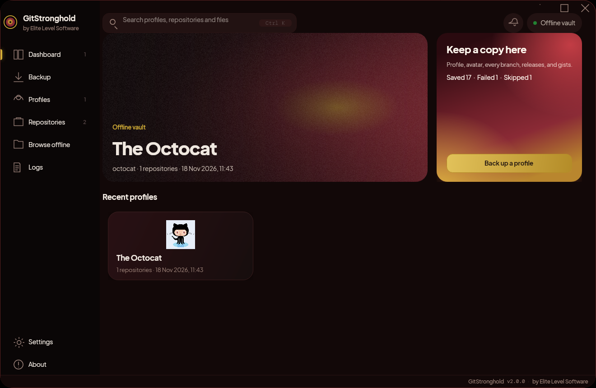

<div align="center">


# GitStronghold

by Elite Level Software

[](LICENSE)
[](https://dotnet.microsoft.com/)
[](#download)
[](https://github.com/EliteLevelSoftware/GitStronghold/releases)
[](https://github.com/EliteLevelSoftware/GitStronghold/releases)
[](https://github.com/EliteLevelSoftware/GitStronghold/releases/latest)

An offline snapshot of a GitHub profile, kept on your machine.

[Download](#download)



</div>

## Download

Installers are on the [releases](https://github.com/EliteLevelSoftware/GitStronghold/releases) page. `<version>` is the release version, for example the version in `Directory.Build.props`.

`GitStronghold-<version>-Windows-Setup.exe` installs per user and does not need administrator rights.

`GitStronghold-<version>-macOS-AppleSilicon-Setup.pkg` is the Apple silicon installer. `GitStronghold-<version>-macOS-Intel-Setup.pkg` is the Intel installer. Both are unsigned, so Gatekeeper asks before the app opens.

`GitStronghold-<version>-Linux-x64.AppImage` is the Linux build. Mark it executable, then run it.

`SHA256SUMS.txt` is the SHA-256 digest of the files on that release. Check a download with `sha256sum -c SHA256SUMS.txt`. The same release includes `*-full.nupkg` packages and `releases.*.json` files. Those are what GitStronghold's built-in updater downloads.

GitStronghold checks those public releases for updates when it starts. The check stays quiet when the repository has no release yet, and it can be turned off under Settings. The public releases need no token.

You can also build from source.

## Backup

Type a GitHub user, an organization, or `owner/repo`. GitStronghold writes a snapshot into the vault folder on this machine. The snapshot holds the profile and avatar, every file on every branch, releases with their notes and assets, gists, and the repository metadata.

The copy is made with the GitHub API. Git does not need to be installed. A fine-grained personal access token is optional. With one, private repositories that belong to the token owner are included. The token is stored with the operating system secret store: DPAPI on Windows, the login keychain on macOS, and libsecret on Linux. It is not written into settings or into the log, and it is sent only to `api.github.com` over HTTPS.

An incremental backup skips a file whose Git blob sha is already in the vault. The backup folder, the incremental switch, and the completion notice are in Settings.

## Browse offline

Open a profile and read the snapshot without a network. Source files open in a monospace view. Markdown is rendered in the window. Remote images and scripts are removed before anything is drawn. A link leaves the app only when it is `http` or `https`, and then only in the system browser. The window itself never navigates to a remote page.

## Profiles

Each profile is one folder inside the vault. The dashboard lists them. Deleting a profile removes that folder and nothing outside the vault.

## Build

```text
dotnet test
dotnet run --project src/GitStronghold.App
```

The version and the publisher name come from `Directory.Build.props`.

## Legal

GitStronghold stores copies of repositories you are allowed to read. It does not modify GitHub. GitHub is a trademark of its owner. Elite Level Software is not affiliated with GitHub.

Changes are in [CHANGELOG.md](CHANGELOG.md). Third-party licenses are in [THIRD_PARTY_NOTICES](THIRD_PARTY_NOTICES). This project is [MIT](LICENSE) licensed, copyright Elite Level Software.
